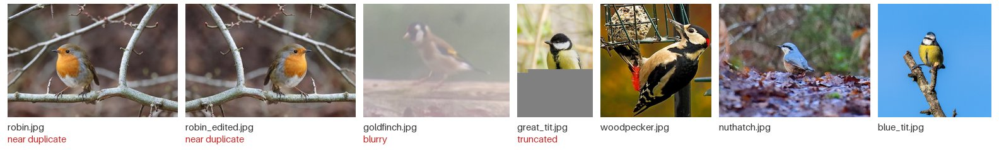

# Immaculate

[](https://pypi.org/project/immaculate/)
[](https://pypi.org/project/immaculate/)
[](https://github.com/Pbatch/Immaculate/actions/workflows/ci.yml)
[](https://pbatch.github.io/Immaculate/)

Find problematic images fast.

## Installation

```bash
pip install immaculate
```

## Usage



```python
from immaculate import Blurry, NearDuplicates, find_issues

issues = find_issues("photos/")
issues.near_duplicates  # [[PosixPath('photos/robin.jpg'), PosixPath('photos/robin_edited.jpg')]]
issues.blurry  # [PosixPath('photos/goldfinch.jpg')], and likewise for each check below
issues.truncated  # [PosixPath('photos/great_tit.jpg')]

issues = find_issues("photos/", [NearDuplicates(), Blurry()])  # only some checks
```

Or from the command line:

```console
$ immaculate photos/ --issues near_duplicates blurry
Near duplicates: 1 set

  photos/robin.jpg
  photos/robin_edited.jpg

Blurry: 1 image
  photos/goldfinch.jpg
```

## Checks

| Check | On the command line | Finds | Settings (defaults) |
|---|---|---|---|
| `ExactDuplicates` | `exact_duplicates` | Images with identical pixels, even if saved with different metadata or in another lossless format | |
| `NearDuplicates` | `near_duplicates` | Resized, recompressed, flipped and rotated copies; see [methods](https://pbatch.github.io/Immaculate/checks/#near-duplicates) | `method` (`"pdq"`) |
| `Dark` | `dark` | Images that are almost all dark | `brightness` (0.32), `fraction` (0.01) |
| `Light` | `light` | Images that are almost all light | `brightness` (0.95), `fraction` (0.05) |
| `Blurry` | `blurry` | Blurry images | `sharpness` (5.0) |
| `LowInformation` | `low_information` | Images with few distinct colors, such as blank ones | `entropy` (3.0) |
| `OddAspectRatio` | `odd_aspect_ratio` | Unusually long or tall images | `ratio` (0.35) |
| `OddSize` | `odd_size` | Images much larger or smaller than the others | `iqr_factor` (3.0) |
| `Grayscale` | `grayscale` | Grayscale images, including color files whose pixels are all gray | `tolerance` (2) |
| `LowContrast` | `low_contrast` | Washed-out, foggy or otherwise flat-looking images | `contrast` (0.05) |
| `Truncated` | `truncated` | Images whose files end early, such as interrupted downloads, which often still decode with a gray patch | |

Pass each check with its settings, such as `Dark(brightness=0.2)`, or `Dark()` for the defaults.

See [checks](https://pbatch.github.io/Immaculate/checks/) for what each setting does.

## Benchmarks

Every check CleanVision has, run together on 250 images of [INRIA Copydays](https://thoth.inrialpes.fr/~jegou/data.php.html#copydays):

| | Time | Peak memory | Images flagged |
|---|---:|---:|---:|
| Immaculate | **0.73 s** | **387 MiB** | 12 |
| CleanVision | 14.12 s | 2,974 MiB | 12 |

See the [benchmarks](https://pbatch.github.io/Immaculate/benchmarks/) for how this was run, and for comparisons with other libraries.
